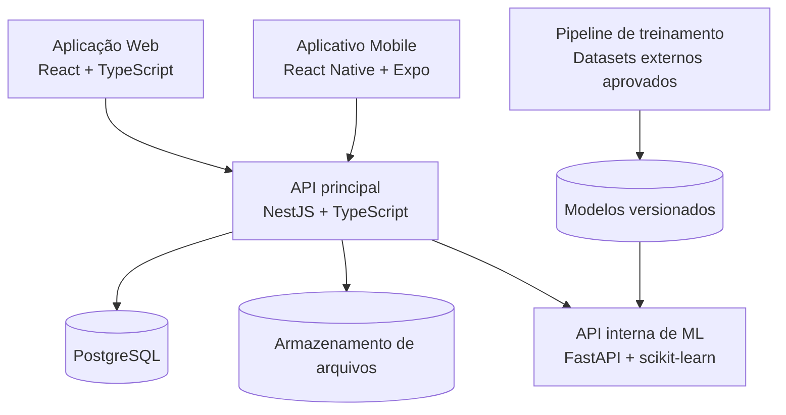

# SGEI — Sistema de Gestão do Ensino Superior Inteligente

**Gestão acadêmica e análise preditiva de evasão no ensino superior.**

O **SGEI** é uma solução em desenvolvimento para apoiar instituições de ensino superior na gestão de estudantes, cursos, turmas, disciplinas e atividades acadêmicas. O projeto combina uma aplicação web responsiva, um aplicativo móvel e serviços de análise de dados, permitindo acompanhar a trajetória acadêmica e identificar situações que merecem atenção.

O objetivo é reunir informações acadêmicas em um ambiente único e oferecer **indicadores e estimativas para apoiar decisões humanas**, sem automatizar ações que afetem a vida acadêmica dos estudantes.

## Funcionalidades previstas

- **Gestão acadêmica:** cadastro de instituições, cursos, turmas, disciplinas, matrículas, docentes e tutores.
- **Frequência e avaliações:** lançamento de presenças, faltas e notas, cálculo de médias e acompanhamento por período letivo.
- **Ocorrências e materiais:** registro de ocorrências acadêmicas, envio e consulta de planos e materiais de aula.
- **Acompanhamento do estudante:** consultas a notas, frequência e histórico acadêmico por meio da web e, progressivamente, do aplicativo móvel.
- **Indicadores e ranking:** painéis por turma, curso e instituição, com regras de privacidade configuráveis.
- **Análise de evasão:** sinalização inicial por regras acadêmicas e, em uma etapa posterior, classificação preditiva por Machine Learning.
- **Controle de acesso:** perfis de administração, coordenação, professor, tutor e aluno, com permissões delimitadas conforme o vínculo acadêmico.

## Machine Learning e análise de evasão

A análise preditiva utiliza um **modelo de classificação multiclasse** para estimar três situações possíveis, de acordo com as classes do conjunto de dados de referência:

| Classe do modelo | Significado |
| --- | --- |
| `Dropout` | Evasão do curso |
| `Enrolled` | Estudante ainda matriculado no recorte analisado |
| `Graduate` | Conclusão do curso |

A probabilidade associada a `Dropout` pode apoiar a identificação de estudantes com maior risco estimado de evasão. Os resultados também podem apresentar fatores associados, sem estabelecer relações de causa e efeito.

O sistema adota uma separação explícita entre **treinamento e inferência**:

- O treinamento é realizado de forma independente, **exclusivamente com conjuntos de dados externos selecionados e aprovados**.
- Os dados acadêmicos operacionais são utilizados para gerar previsões e avaliar seu desempenho posterior, **nunca para treinar ou retreinar automaticamente o modelo**.
- As estimativas dependem da disponibilidade e compatibilidade dos atributos exigidos pelo modelo e de validação apropriada para a população atendida.
- Nenhuma previsão provoca, por si só, sanções, reprovações ou intervenções automáticas.

**As previsões são estimativas estatísticas e não substituem a avaliação de profissionais da instituição.**

## Tecnologias

| Camada | Tecnologias | Finalidade |
| --- | --- | --- |
| Web | React, TypeScript | Interface responsiva para gestão e acompanhamento |
| Mobile | React Native, TypeScript, Expo | Aplicativo de consultas e acompanhamento acadêmico |
| API principal | NestJS, Node.js, TypeScript, Prisma | Regras de negócio, autenticação, autorização e integração |
| API de ML | Python, FastAPI, Pydantic | Serviço interno para inferência e metadados do modelo |
| Modelagem preditiva | scikit-learn | Treinamento, avaliação e classificação |
| Banco de dados | PostgreSQL | Persistência das informações acadêmicas |
| Infraestrutura | Docker, Docker Compose | Padronização dos ambientes e serviços |

### Visão geral da arquitetura

As interfaces web e mobile se comunicam com a **API NestJS**. O serviço FastAPI permanece interno e é consultado pela API principal para realizar inferências. O treinamento é executado separadamente do atendimento das requisições.

## Perfis de usuário

| Perfil | Principais responsabilidades |
| --- | --- |
| **Administrador** | Configuração institucional, usuários e gestão dos modelos de análise |
| **Coordenação** | Acompanhamento acadêmico, indicadores e análises institucionais |
| **Professor** | Registro de aulas, notas, frequência e ocorrências das suas turmas |
| **Tutor** | Acompanhamento dos estudantes sob sua tutoria |
| **Aluno** | Consulta às próprias informações acadêmicas e materiais disponíveis |

As previsões individuais de risco são destinadas apenas aos perfis autorizados; **os estudantes não visualizam seus escores de risco de evasão**.

## Organização do desenvolvimento

As branches mantidas são `main`, `back/prototype` e `mobile/prototype`.

| Branch | Responsabilidade |
| --- | --- |
| `main` | Apresentação e integração futura, preservada; sem merges automáticos |
| `back/prototype` | API NestJS, Prisma, PostgreSQL, ML/FastAPI e infraestrutura dos serviços |
| `mobile/prototype` | Aplicativo Expo/React Native e integração com os contratos da API |

Antes de editar, confira `git branch --show-current` e trabalhe na branch do componente. Não recrie branches `infra/*` ou `ml/*`. Mudanças que atravessam componentes são feitas nas duas branches, respeitando os contratos da API. Não mover toda a integração para uma terceira branch.

Para executar localmente: na branch backend, inicie os serviços Docker; na branch mobile, inicie o Expo. Os containers usam as imagens construídas no backend. Recompilar serviços exige voltar à branch backend. Alternativamente, use checkouts separados dessas mesmas branches, sem criar novas branches.

## Evolução do projeto

O desenvolvimento está planejado em etapas:

1. **Base de gestão acadêmica:** estrutura institucional, usuários, autenticação, frequência, notas, ocorrências e materiais.
2. **Indicadores de acompanhamento:** rankings com privacidade, painéis acadêmicos e sinalização de risco baseada em regras.
3. **Machine Learning:** treinamento externo, avaliação, publicação de modelos e integração de previsões à plataforma.
4. **Aplicativo móvel:** consultas acadêmicas integradas à API principal.
5. **Aprimoramentos:** monitoramento das previsões, relatórios, segurança e validação contínua dos resultados.

## Segurança e privacidade

O SGEI foi concebido considerando a **Lei Geral de Proteção de Dados (LGPD)**, isolamento de informações entre instituições, autorização por perfil e vínculo acadêmico, auditoria de operações sensíveis e minimização dos dados compartilhados com o serviço de Machine Learning.

A implantação com informações reais exige avaliação institucional e jurídica, além de validação do desempenho e das limitações do modelo no contexto de utilização.

---

**SGEI — Tecnologia para apoiar a gestão e o acompanhamento acadêmico no ensino superior.**
